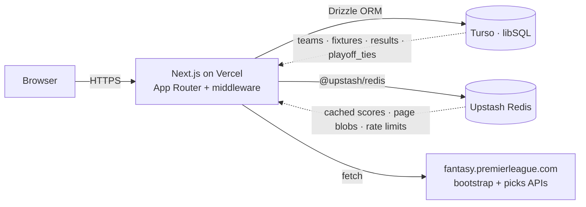

# 01 · Architecture

## Stack

| Layer | Choice |
|---|---|
| Framework | Next.js 16 (App Router, React Server Components) |
| Language | TypeScript |
| Database | Turso (libSQL — a hosted SQLite fork) accessed via Drizzle ORM |
| Cache | Upstash Redis (REST API) |
| Hosting | Vercel (Hobby tier) |
| Auth | Custom session cookie (HMAC-SHA256) — see [`src/lib/auth.ts`](../src/lib/auth.ts). A session is a person (`user` / `admin` / `superadmin`) or, in legacy leagues, a team login. See [10-accounts-and-membership.md](10-accounts-and-membership.md) |
| External data | Fantasy Premier League public API (`fantasy.premierleague.com/api/...`) |
| Styling | Tailwind CSS v4 (no separate config — `@import "tailwindcss"` in `globals.css`) |
| Schema migrations | Drizzle Kit |

## System diagram



## Request lifecycle

Every API request goes through `src/middleware.ts` first. The middleware:

1. Lets through public GETs (the read-only standings, fixtures, playoffs/bracket, and auth endpoints).
2. For cron routes (`/api/cron/*`), validates `Authorization: Bearer ${CRON_SECRET}` and injects synthetic admin headers.
3. For all other API routes, verifies the session cookie via `verifySession()`. On success it forwards `x-session-id`, `x-session-type`, and (where applicable) `x-league-id` headers to the route handler.
   - `/api/admin/*` requires an `admin` or `superadmin` session; `getAuthorizedLeagueId` then checks the league.
   - `/api/team/*` lets any valid session through. **Which team** it acts as — and whether a person is on one at all — is decided in the route by `resolveTeamActor` ([`src/lib/team-actor.ts`](../src/lib/team-actor.ts)), from the league named in the URL plus a membership lookup. Team-scoped routes never read `x-session-id` as a team id; a unit test enforces it.
4. Applies rate limits — per-IP on auth + reset-season; per-admin (session ID keyed) on 5 expensive POST endpoints (generate-playoffs, generate-brackets, advance-playoffs, create-gameweeks, process-all/league-gw).

The rate limiter is **fail-open**: if Upstash is unreachable, requests pass through and the error is logged. Better to let real traffic flow than to hang on a transient Redis blip.

## Why these choices

- **Vercel Hobby** — free tier, 60-second function timeout, 2 cron jobs max. The architecture works inside these limits (see [05-auto-processing.md](05-auto-processing.md) for how).
- **Turso (libSQL)** — SQLite-compatible, cheap, fast, supports edge replication. Drizzle ORM gives type-safe SQL without sacrificing performance.
- **Upstash Redis** — REST-based (no TCP connection needed in serverless), free tier covers our cache footprint, integrates trivially with Vercel.
- **Next.js App Router** — Server Components + middleware + route handlers all in one mental model. Layouts hydrate per-league context once (see `src/app/[leagueSlug]/layout.tsx`).
- **FPL public API** — no auth required for read-only data. We hit `bootstrap-static` for season-wide events and `entry/{id}/event/{gw}/picks` for per-manager scores.

## Environment variables

The full list lives in [07-deployment.md](07-deployment.md). The non-optional set:

```
DATABASE_URL                  # Turso libsql:// URL (or file:./dev.db for local)
TURSO_AUTH_TOKEN              # Turso JWT (omit for local SQLite)
SESSION_SECRET                # 32+ byte random string for HMAC signing
UPSTASH_REDIS_REST_URL        # Upstash REST endpoint
UPSTASH_REDIS_REST_TOKEN      # Upstash REST token
CRON_SECRET                   # Bearer token for the legacy cron route (optional, kept for emergencies)
```

Missing `SESSION_SECRET` throws on startup (deliberate — no insecure default).
Missing Upstash creds disables rate limiting and caching (the app still works, just slower).

## Deployment model

A single Vercel project deploys the entire Next.js app. There are no separate workers or background jobs. The platform was previously driven by a Vercel cron job that called `/api/cron/process-scores` daily; that has been replaced by a superadmin-triggered button (the orchestration is documented in [05-auto-processing.md](05-auto-processing.md)). The cron route stays in code as an emergency fallback callable via `CRON_SECRET`.

## See also

- [02-data-model.md](02-data-model.md) — schema and entity relations.
- [05-auto-processing.md](05-auto-processing.md) — orchestration that uses everything described here.
- [07-deployment.md](07-deployment.md) — env vars and Vercel/Turso/Upstash setup.
