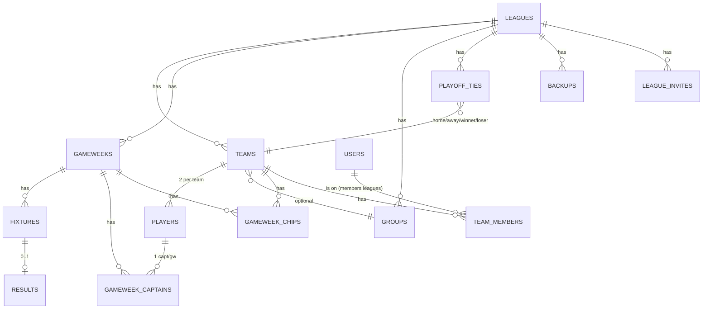

# 02 · Data model

All tables are defined in [`src/lib/db/schema.ts`](../src/lib/db/schema.ts). Drizzle generates migrations into `drizzle/` (run `npm run db:generate` after schema changes, then `npm run db:push` to apply).

## Entity relationships (core)



## Tables

### Core platform

| Table | Purpose |
|---|---|
| `users` | One row per **person**: `role` = `"superadmin"` \| `"admin"` \| `"user"` (player). Also `username` (unique, lowercase), `avatarUrl`, `fplEntryId`, `lastLoginAt` and `sessionVersion` (bump it to revoke every session). Google-only accounts store `password = ""`. In **legacy** leagues teams still log in via `teams.teamLoginId` + `teams.password`, not via this table. |
| `leagues` | One row per league. Holds `format` (`"tvt"` \| `"continental-championship"` \| `"auction"`), `teamSize`, `groupCount`, `playoffStartGw`, `enabledChips` (JSON array of 3 chip codes), `initialBudget` (auction), `season`, `slug`, `name`, and `authMode` (`"legacy"`: team logins; `"members"`: people join via invite). |
| `league_admins` | Many-to-many between users and leagues. Defines which admin has access to which league. |
| `user_identities` | External sign-ins (Google `sub`) linked to a user. |
| `team_members` | Who is on which team in members-mode leagues. Unique `(leagueId, userId)`: one team per person per league. `role` owner/member; `playerId` = the FPL slot this person fills. |
| `league_invites` | Invite links: league invites (claim an open slot) and partner invites (`teamId` set). |
| `join_requests` | Joins awaiting admin approval. |
| `auth_handoffs` | Short-lived iOS home-screen sign-in handoffs. |
| `settings` | Per-league key-value config (e.g. `groupsRevealed`, `captainAnnouncementEnabled`). Composite PK on `(key, leagueId)`. |
| `audit_logs` | Append-only timeline for diagnostic events. The orchestrator writes `CRON_RUN_START` / `CRON_RUN_END` pairs per superadmin run. |

### Teams and players

| Table | Purpose |
|---|---|
| `teams` | One row per team. Has `teamLoginId` (human-readable credential), `password` (bcrypt hashed), `groupId` (optional FK to `groups`), `leaguePoints` and `bonusPoints` running totals, plus per-chip-set "used" flags (`winWinSet1Used`, etc.). |
| `players` | One row per FPL manager. Two rows per team. Has `fplId` (the manager's FPL entry ID — used for fetching their picks). |
| `groups` | League groups (e.g. Group A / Group B for TVT; A/B/C/D for Continental Championship cup groups; "Playoffs" group for knockout fixtures). `groupType` distinguishes regular-season groups from playoff/cup groups. |

### Gameweeks, fixtures, results

| Table | Purpose |
|---|---|
| `gameweeks` | One row per GW number per league. Has `deadline` (FPL deadline). Composite uniqueness on `(leagueId, number)`. |
| `fixtures` | A scheduled match between two teams in a specific GW. Has `competitionType` (`null` \| `"jpl"` \| `"cup-group"` \| `"jcl-knockout"` \| `"jel-knockout"`), `isPlayoff` (boolean), `groupId`, `tieId` (links to `playoff_ties.tieId`), `leg` (for 2-leg ties). |
| `results` | One row per scored fixture. Carries `homeScore`, `awayScore`, `homeMatchPoints`, `awayMatchPoints`, `homeGotBonus`, `awayGotBonus`, `homeUsedDoublePointer`, `awayUsedDoublePointer`, plus JSON player breakdowns (`homePlayerScores`, `awayPlayerScores`). One `results` row exists only after the fixture has been scored. |

### Per-GW state

| Table | Purpose |
|---|---|
| `gameweek_captains` | One row per team per GW. Has `playerId` (which of the team's 2 players is captain), `fplScore`, `doubledScore`, `isValid` (false when auto-assigned post-deadline). |
| `gameweek_chips` | One row per chip play. Has `teamId`, `gameweekId`, `chipType` (`"W"` \| `"D"` \| `"C"` \| `"SL"` \| `"CB"` \| `"UD"`), `challengedTeamId` (Challenge Chip only), `isValid`, `isProcessed`, `pointsAwarded`, `hadNegativeHits`. |

### Playoffs

| Table | Purpose |
|---|---|
| `playoff_ties` | A bracket node. Primary key is `tieId` (e.g. `"16T-FINAL"`, `"JCL-FINAL"`, `"C-37-A"`). Has `homeTeamId`, `awayTeamId`, `homeAggregate`, `awayAggregate`, `winnerId`, `loserId`, `status` (`"pending"` \| `"leg1_done"` \| `"leg2_done"` \| `"complete"`), `gw1`/`gw2`/`gw3` (GW numbers per leg). |
| `challenger_survival_entries` | 16T-specific: per-team scores in the survival round at GW33. Used to rank survival into the C-34 KO. |

### Auction format

| Table | Purpose |
|---|---|
| `auction_sessions` | One per league per auction round (Initial + Mini). Tracks nomination order and live state. |
| `auction_ownership` | Active player-team ownership rows. Has `purchasePrice`, `status` (`"active"` \| `"released"`). |
| `auction_scores` | Per-team per-GW snapshot with `totalScore` and `playerBreakdown` JSON. Source of truth for cumulative standings. |
| `auction_wishlists` | Per-team prioritised lists used for nomination order in mini-auctions. |
| `trade_proposals` | Inter-team trade requests with money + player swap. |
| `notifications` | In-app notifications (currently used by the auction flow for trade events). |

### Cache + recovery

| Table | Purpose |
|---|---|
| `backups` | JSON-row snapshots of an entire league's teams/fixtures/captains/chips. Has `trigger` (`"gw1-lock"` \| `"manual"`). Round-trippable through the corresponding Bulk Upload importers. Written by `maybeWriteGw1Snapshot` (auto-snapshot once per league at first GW1 score) and the optional POST handler in `/api/admin/[leagueId]/backup`. |

### Team penalties / fines

| Table | Purpose |
|---|---|
| `team_penalties` | Optional admin-issued point deductions or warnings, e.g. for code-of-conduct breaches. Currently UI is minimal. |

## Critical relations to know

- **Every fixture's league** is inferred from its `gameweek.leagueId` — there's no direct `fixtures.leagueId` column. Joins always go through `gameweeks`.
- **Playoff fixtures and ties are decoupled** — `playoff_ties` is the bracket tree, `fixtures` are the actual playable matches that reference a tie via `fixtures.tieId`. A 2-leg tie has two fixture rows; both must be scored before `resolve2LegTie` flips the tie to `complete`.
- **`teamLoginId` (the "Team key") is globally unique** — across leagues. Backups, restores and the captain/chip/fixture importers find teams by it, so members-mode teams get one too. It is a login credential **only in legacy leagues**; sign-in refuses it for members leagues.
- **A person's team in a league** is the `team_members` row for `(leagueId, userId)` — at most one. Every team-scoped API resolves it through `src/lib/team-actor.ts`; see [10-accounts-and-membership.md](10-accounts-and-membership.md).
- **`teams.leagueId` is required** — every team belongs to exactly one league. Players inherit their league via their team.

## Schema migrations

```sh
cd jpl-leagues
npm run db:generate          # creates a new migration file in drizzle/
npm run db:push              # applies pending migrations to your DATABASE_URL
```

The latest migration is `drizzle/0025_accounts_membership.sql` (accounts and membership). Migrations from 0021 on are hand-written and applied with idempotent `scripts/apply-*.mjs` scripts rather than `drizzle-kit migrate`.

⚠️ In this repo every database command is limited to a local `file:` database or the `jpl-leagues-accounts` Turso database — see `src/lib/db/target-guard.ts`.

## See also

- [03-formats.md](03-formats.md) — which format uses which tables and how.
- [04-scoring-pipeline.md](04-scoring-pipeline.md) — what gets written to `results` / `gameweek_captains` / `gameweek_chips`.
- [05-auto-processing.md](05-auto-processing.md) — when `playoff_ties.status` flips and what it triggers.
