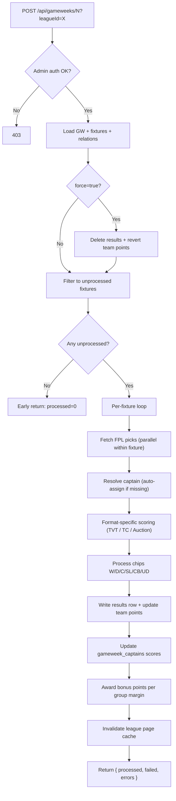

# 04 · Scoring pipeline

The score handler is the heart of the platform. It reads the live FPL API, applies format-specific scoring rules, processes chips, and persists `results` rows. This document traces a single `POST /api/gameweeks/[gw]?leagueId=X` request from request to response.

The handler lives at [`src/app/api/gameweeks/[gw]/route.ts`](../src/app/api/gameweeks/[gw]/route.ts). It's the same handler whether called from the per-league admin UI (manual score) or from the per-GW orchestration (`processOneLeagueOneGw`).

## Flow



## Request payload

- Path: `POST /api/gameweeks/{gw}?leagueId={uuid-or-slug}[&force=true]`
- Headers: middleware-injected `x-session-type=admin|superadmin` and `x-session-id`.
- `force=true` triggers the destructive re-score path (clear results, revert team points, refetch FPL).
- `leagueId` can be a slug — the route resolves it to a UUID before querying.

## Format dispatch

Lines ~295-345 in the route file:

```ts
if (leagueRow[0]?.format === "continental-championship") {
  return processContinentalChampionshipGameweek(...);   // delegates to src/lib/sports/fpl/formats/continental-championship/process-gameweek.ts
}
if (leagueRow[0]?.format === "auction") {
  return processAuctionGameweek(...);       // delegates to src/lib/sports/fpl/formats/auction/process-gameweek.ts
}
// TVT default — inline below
```

Each format has its own scoring rules (see [03-formats.md](03-formats.md)). The remainder of this doc describes the **inline TVT path** since it's the most commonly hit and the most complex.

## TVT scoring sequence (one fixture)

For each unprocessed fixture in the GW:

1. **Captain resolution** — read the most recent valid `gameweek_captains` row for each team. If none exists, `autoAssignDefaultCaptain` picks the lower-scoring player (a penalty for not submitting). Auto-assigned captains write `isValid: false` so the UI can show a "temp captain" badge.

2. **FPL fetch (parallel per fixture)** — both teams' 2 players are fetched in parallel via `Promise.all` over `calculateTeamGameweekScore(player.fplId, gw, leagueId)`. That helper checks the per-(fplId, gw, leagueId) Upstash cache first; on miss it hits `/api/entry/{fplId}/event/{gw}/picks/` and caches the result for 24h.

3. **Carry-forward hit deduction** — `playerGwHitsMap` from the prior GW is consulted. Any player who took >12 raw transfer hits in GW N-1 has their full hit total carried into GW N as a deduction.

4. **TVT team score** — `calculateTVTTeamScore(scores)` sums both players (already net of hits) and doubles the captain.

5. **Match result** — `determineMatchResult(homeEffectiveScore, awayEffectiveScore)` returns `{ homeMatchPoints, awayMatchPoints }` per W=2/D=1/L=0.

6. **Chip processing** — for each chip the team played this GW:
   - **W (Win-Win)** — if total hits ≤ 0: forces 2 match points; otherwise wasted (`hadNegativeHits=true`).
   - **D (Double Pointer)** — doubles match points (and later, the bonus point too).
   - **C (Challenge)** — Challenge Chip against a top-2 team in the opposite group; bonus points are awarded separately based on the outcome vs the challenged team.
   - **SL (Score Lock)** — caps team score variance.
   - **CB (Comeback)** — bonus if the team comes back from behind.
   - **UD (Underdog)** — bonus if lower-ranked team beats higher-ranked.

   The `gameweek_chips` row is updated with `isProcessed: true`, `pointsAwarded`, and `hadNegativeHits`.

7. **Result persistence** — a new `results` row is inserted with the final scores, match points, bonus flags, and per-player score JSON breakdowns.

8. **Team points update** — `teams.leaguePoints` += `matchPoints + bonusPoints + chipExtras`. `teams.bonusPoints` += bonus indicator. This running total drives standings.

9. **Captain score writeback** — `gameweek_captains` row gets `fplScore`, `transferHits`, `doubledScore` populated.

## Bonus point calculation (cross-fixture phase)

After every fixture in the GW is processed, the handler awards exactly **one Bonus Point per group** to the team with the highest **margin of victory** (winners only — losing teams can't earn the bonus regardless of margin). A team that played the Double Pointer chip gets a doubled bonus (2 pts).

This phase needs all fixtures done first so it lives after the per-fixture loop.

## Cache invalidation

After scoring, the route calls `invalidateLeaguePageCache(leagueId)` which deletes:
- `standings:{leagueId}`
- `fixtures:{leagueId}`
- `playoffs:{leagueId}`

These are the page-level cache blobs in Upstash (see [06-caching.md](06-caching.md)). Next page render recomputes from the fresh `results` rows.

## Idempotency

- Without `force=true`: only fixtures with no `results` row are scored. Re-calling on a fully-scored GW is a near-instant no-op.
- With `force=true`: every existing `results` row is deleted, team points are reverted (subtracting the previous awards), and chips are reset to `isProcessed: false`. Then scoring proceeds as fresh.

## Pre-flight by callers

The orchestrator (`processOneLeagueOneGw`) does its own pre-flight: it queries whether any fixture in the GW has a NULL `results` row. If none, it skips calling the handler entirely. This avoids the heavy eager-load even for `processed=0` early returns.

## Failure modes

- **FPL fetch fails** (rate limit, network) — the per-player try/catch returns `0/0` for that player; processing continues with degraded scores. A follow-up `force=true` once FPL recovers will produce correct numbers.
- **DB write fails** — the per-fixture try/catch records the error, continues to the next fixture, and the response's `errors` array surfaces it to the admin.
- **Captain row missing entirely** — `autoAssignDefaultCaptain` handles this gracefully and writes a new `gameweek_captains` row with `isValid: false`.

## See also

- [03-formats.md](03-formats.md) — TC and Auction processor entry points.
- [05-auto-processing.md](05-auto-processing.md) — how this handler gets called from the orchestrator.
- [06-caching.md](06-caching.md) — the FPL score cache and invalidation flow.
