# 05 · Auto-processing — the superadmin button

When a Premier League gameweek ends, the superadmin clicks **"Run Auto-Processing for All Leagues"** in the Operations tab. The platform then scores every league, generates any pending playoff brackets, advances ties whose GW just resolved, and refreshes caches — all idempotently.

This document explains the orchestration, the rationale behind it, and how to extend it.

## The architecture in one sentence

The browser orchestrates a **2D loop over (league × gameweek)**, firing one bounded HTTP call per pair. Each call processes score + generate + advance for a single league at a single GW, takes ~100ms-5s, and survives the Vercel Hobby 60-second function ceiling with room to spare.

## Sequence

```mermaid
sequenceDiagram
  participant U as Superadmin
  participant B as Browser
  participant P as /api/admin/process-all/plan
  participant L as /api/admin/process-all/league-gw
  participant F as /api/admin/process-all/finish
  participant DB as Turso
  participant FPL as FPL API
  U->>B: Click "Run Auto-Processing"
  B->>P: GET (writes CRON_RUN_START)
  P->>DB: load active leagues + GWs
  P->>FPL: bootstrap-static (one call)
  P-->>B: { runId, dueGws[], leagues[] }
  loop for each league
    loop for each gw in dueGws
      B->>L: POST { league, gw }
      L->>DB: pre-flight (any unscored fixtures?)
      alt has unscored
        L->>FPL: fetch player scores (parallel)
        L->>DB: write results + invalidate cache
      end
      L->>DB: hasAdvanceWork? if yes, advance dispatcher
      L->>DB: generate playoffs if trigger-gw
      L-->>B: { scored, advanced, generated, errors }
      B-->>U: update GW chip color
    end
  end
  B->>F: POST { runId, results[] }
  F->>DB: writes CRON_RUN_END + GW1 auto-snapshot
```



## Endpoints

| Path | Method | Purpose |
|---|---|---|
| `/api/admin/process-all/plan` | GET | Compute the work list. Reads the FPL `bootstrap-static` once, builds `dueGws` (GWs whose deadline has passed AND FPL marked `finished=true`), pulls the active leagues, writes `CRON_RUN_START` to `audit_logs`, returns `{ runId, dueGws[], leagues[], globalErrors[] }`. |
| `/api/admin/process-all/league-gw` | POST | The workhorse. Body: `{ runId, league, gw }`. Runs `processOneLeagueOneGw` for that pair. Bounded ≤ ~15s. Subject to per-admin rate limit (30/min). |
| `/api/admin/process-all/finish` | POST | Body: `{ runId, dueGws, results, globalErrors }`. Writes `CRON_RUN_END` to `audit_logs`, populates live-FPL cache for any in-progress GW. |

All three are superadmin-only (`isSuperAdmin` check).

## The "one league × one GW" unit

`processOneLeagueOneGw` lives in [`src/lib/sports/fpl/cron/process-all.ts`](../src/lib/sports/fpl/cron/process-all.ts). For a given `(league, gw)` it:

1. **Clears the live FPL cache** for that GW (so subsequent reads pick up fresh data).
2. **Pre-flight scoring check** — counts unscored fixtures for this league at this GW via a cheap SQL query. If 0, sets `scoreSkipped: true`. If >0:
   - For auction: invokes `processAuctionGameweek(...)` directly (in-process).
   - For other formats: calls `scorePost` (the score handler) via `callHandlerDirect` (constructs a `NextRequest`, invokes the handler function, parses the response — no HTTP roundtrip).
3. **Generate check** — `getPlayoffGenerateAction(format, teamSize, playoffStartGw, gw)` returns truthy only at `playoffStartGw - 1` for this league. If truthy, calls `generatePlayoffsPost` or `generateBracketsPost` in-process. A 400 "already exists" response flips `generatedAlready: true` (not an error).
4. **Advance check** — if `gw` is in the league's `getPlayoffAdvanceGws(...)` window:
   - First `hasAdvanceWork(leagueId, gw)` queries `playoff_ties` for any tie touching this GW that isn't `complete`. If none, sets `advanceSkipped: true` (avoids ~10s of dispatcher overhead).
   - Otherwise calls `advancePlayoffsImpl(leagueId, gw)` directly.
5. **GW1 auto-snapshot** — at the end, if `gw === 1` and no errors and no prior `gw1-lock` backup row exists, `maybeWriteGw1Snapshot` writes a JSON-row backup to `backups`. Wrapped in try/catch so backup failure never breaks scoring.
6. Returns `LeagueGwResult { scored, scoreSkipped, generated, generatedAlready, advanced, advanceSkipped, errors[] }`.

## Why in-process calls (not HTTP)

Earlier iterations had the orchestrator make actual HTTPS `fetch()` calls to the score / generate / advance endpoints. Two problems killed that:

1. **Vercel Deployment Protection** intercepted same-origin internal fetches with an HTML SSO redirect, breaking JSON parsing on every call.
2. Each inner fetch paid ~250ms of edge + middleware overhead. Multiply by ~70 calls per per-league run and you were burning seconds on roundtrips alone.

The fix was to import the route handler functions directly and invoke them with a constructed `NextRequest`. See `callHandlerDirect` in [`src/lib/sports/fpl/cron/process-all.ts`](../src/lib/sports/fpl/cron/process-all.ts) — sets the headers middleware would normally inject (`x-session-type: superadmin`, etc.), constructs the request, awaits the handler. Zero HTTP, zero edge layer.

## Browser orchestration

In [`src/app/superadmin/page.tsx`](../src/app/superadmin/page.tsx), the click handler:

```ts
const plan = await fetch("/api/admin/process-all/plan");
for (const league of plan.leagues) {
  for (const gw of plan.dueGws) {
    setLeagues(prev => mark(prev, league.id, gw, "processing"));
    const r = await fetch("/api/admin/process-all/league-gw", { body: { league, gw }});
    setLeagues(prev => mark(prev, league.id, gw, r.status));
  }
}
await fetch("/api/admin/process-all/finish", { body: { runId, results }});
```

Each per-GW result updates a live progress chip inside the league card. Users see real-time progress instead of a single opaque spinner.

## Idempotency guarantees

- **Score**: a fixture with an existing `results` row is skipped via the pre-flight + handler's internal filter.
- **Generate**: returns 400 "already exists" if the bracket is in place; the orchestrator treats this as `generatedAlready: true` (success).
- **Advance**: `resolve2LegTie` / `resolve1LegTie` short-circuit on `status="complete"`; `create2LegTie` uses `onConflictDoNothing`; `markLeg1Done` no-ops past leg 1. `hasAdvanceWork` skip avoids even calling the dispatcher when every tie is already resolved.

Net effect: re-clicking "Run Auto-Processing" at any time is safe and fast.

## Rate limiting

The 5 expensive POST endpoints have a per-admin (keyed by `session.id`) rate limit of **30 requests / 60 seconds**:

- `/api/admin/[leagueId]/generate-playoffs`
- `/api/admin/[leagueId]/generate-brackets`
- `/api/admin/[leagueId]/advance-playoffs`
- `/api/admin/[leagueId]/create-gameweeks`
- `/api/admin/process-all/league-gw`

The limit is wired in [`src/middleware.ts`](../src/middleware.ts). It's **fail-open** — if Upstash is unreachable, requests pass through.

## Audit trail

Every Auto-Processing click writes two `audit_logs` rows:
- `CRON_RUN_START` (from `/plan`) — includes the build SHA and any global errors (e.g. FPL bootstrap fetch failure).
- `CRON_RUN_END` (from `/finish`) — includes a summary of every league's outcome counts.

Both share a `runId` so support can pull the full timeline of a single run.

## Manual cron fallback

`/api/cron/process-scores` is kept in code as an emergency one-call fallback. It's gated by `CRON_SECRET` (Bearer auth) and runs the entire `processAllLeagues` flow server-side in one Vercel function invocation. **It will time out on large multi-league deployments** — the proper path is the browser-orchestrated button. The fallback exists for debugging and for one-off `curl` invocations when the UI is unavailable.

## See also

- [04-scoring-pipeline.md](04-scoring-pipeline.md) — what the score handler does when invoked.
- [06-caching.md](06-caching.md) — cache invalidation triggered by scoring.
- [08-engineering-decisions.md](08-engineering-decisions.md) — rationale for in-process calls and per-GW units.
