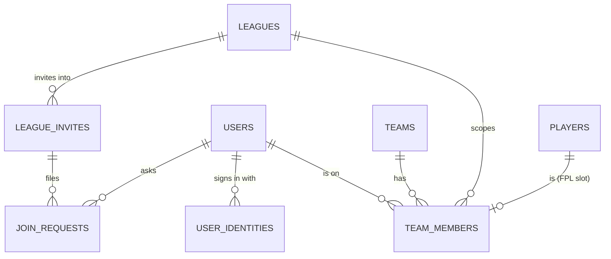

# 10 · Accounts and membership

How people sign in, and how one person plays in many leagues. This replaces the original model, where each team row was its own login handed out by an admin.

**Google is the only way to sign in** — for players, league admins and the superadmin alike. There are no passwords anywhere: no team logins, no admin passwords, no break-glass.

## Status

| Phase | What | State |
|---|---|---|
| 1 | Schema (migration 0025), `resolveTeamActor`, league-scoped viewer, route refactor, guard tests, database target guard | **Built** |
| 2 | Google sign-in, usernames, `/onboarding`, `/account`, in-app-browser handling, iOS handoff (behind a flag), role refresh and revocation, passwordless admins | **Built** |
| 3 | Members-mode leagues: invites, join, approval, partner invites, admin Members tab, league switcher, dashboard under `/[leagueSlug]` | **Built** |
| 4 | Team logins and every password removed (brought forward from "after the 2026-27 season"); old leagues are switched to Google sign-in by the superadmin | **Built** |

## Leagues and `auth_mode`

Every session is a **person** — `{ type: "user" | "admin" | "superadmin", id: userId, sv }` — signed in with Google. Who is on a team is `team_members` rows, and one person in many leagues is one identity: switching leagues is navigation.

Every league has an `auth_mode`:

| | `members` | `legacy` |
|---|---|---|
| What it is | Every league created now | A league from before accounts (team key + password per team) that hasn't been switched yet |
| Who can act for a team | Its members (`team_members`) | Nobody — its team logins no longer work |
| How people get on a team | Invite link, teammate invite, or the admin's Members tab | None until it's switched |

**Switching an old league** (`switchLeagueToGoogleSignIn` in [`src/lib/membership.ts`](../src/lib/membership.ts); Superadmin → Football → Leagues → *Switch to Google sign-in*, or `PATCH /api/superadmin/leagues/[id] { authMode: "members" }`):
- sets `auth_mode = "members"` and wipes the old team password hashes; teams, players, fixtures, scores and history are untouched;
- writes a `LEAGUE_SWITCHED_TO_GOOGLE` audit row, and can't be undone;
- creates **no** league invite. After the switch every team is open, and a league invite gives whoever opens it the next open team, not their own. So players sign in with Google and send the admin their username, and the admin puts each one on their own team from the Members tab (assign by username).

Until a league is switched, its admin page shows a banner saying so, and its format help tells players what to do.

`POST /api/superadmin/leagues` always creates `members` leagues; `authMode: "legacy"` is refused. FPL Classic leagues are public, have no accounts, and keep `legacy` so every join path stays closed for them.

## Data model

Migration [`drizzle/0025_accounts_membership.sql`](../drizzle/0025_accounts_membership.sql) is purely additive. Apply it with [`scripts/apply-0025-accounts-membership.mjs`](../scripts/apply-0025-accounts-membership.mjs). The script is idempotent and refuses any database but this repo's own.



| Table / column | Purpose |
|---|---|
| `users` | Now **one row per person**: admins, superadmins and players. Adds `username` (unique, lowercase, null until onboarding), `avatar_url`, `fpl_entry_id`, `last_login_at` and `session_version`. Google-only accounts store `password = ""`. |
| `user_identities` | External sign-ins, unique on `(provider, provider_subject)`, e.g. Google's `sub`. |
| `team_members` | Who is on which team: `role` is `owner`/`member`, and `player_id` is the FPL slot this person fills. Unique `(league_id, user_id)` means **one team per person per league**. There is at most one owner per team (partial unique index). |
| `league_invites` | Invite links. `team_id` null = league invite (claims an open slot); set = partner invite. Has `max_uses`, `use_count`, `expires_at`, `revoked_at`, `requires_approval`. |
| `join_requests` | Joins waiting for an admin, via invites that require approval. |
| `auth_handoffs` | Five-minute, single-use records for the iOS home-screen sign-in handoff. |
| `leagues.auth_mode` | `legacy` (default for every existing row: not yet switched) or `members`. |
| `teams.team_login_id` | The **Team key**: a stable identifier that backups, restores and importers match teams by. It is not a credential. |
| `audit_logs.user_id`, `.league_id` | Who and where, for membership events. |
| `submitted_by_user_id` on `gameweek_captains` / `gameweek_chips`; `feedback.submitter_user_id` | Which teammate did it. |

**Why the odd bits.**
- `users.password`, `teams.password` and both `must_change_password` columns stay, NOT NULL, but are dead: nothing reads them, and every new row stores `""` / `false`. Old rows may still hold bcrypt hashes; switching a league wipes its teams'. `users.role` keeps its `"admin"` default, so every insert sets `role` explicitly.
- All three would otherwise mean rebuilding a SQLite table that other tables cascade from.

## Resolving the acting team

The rule: **the session says who you are; the URL says which league.**

[`src/lib/team-actor.ts`](../src/lib/team-actor.ts) is the only place a team-scoped API learns which team it is acting as:

- **`resolveTeamActor(request, { league?, teamId? })`** returns `{ actor: { teamId, leagueId, userId, memberRole } }` or `{ denial }`, where the denial is `"unauthenticated"`, `"league-required"` or `"forbidden"`.
  - A person must name the league (`?league=<slug or id>`) or the team. Without one, the result is `league-required`.
  - One indexed query joins `team_members` to `users` and checks membership *and* `users.session_version == token.sv`. Removing a member, or bumping their session version, takes effect on their next request.
- **`sessionActsAsTeam(session, teamId)`**: for "only your own X" checks, where the request names the team (most auction routes).
- **`sessionTeamIdInLeague(session, league)`**: for read endpoints that flag "mine" in league-wide data.
- **`listSessionTeamIds(session)`**: every team the session may act as. This is what lets one notification bell cover all of a person's leagues.
- **`teamActorDenied(denial, messages?)`**: builds the JSON error response, keeping a route's existing wording.

Because the league comes from the URL and never from the cookie:
- switching leagues needs no token swap;
- deep links work;
- a stale tab can't submit a captain for a team its owner has since switched away from.

**Middleware** ([`src/middleware.ts`](../src/middleware.ts)) lets any valid session through to `/api/team/*`. It can't decide membership itself: that needs the league from the URL and a database lookup.

**Guard test.** [`tests/unit/team-actor-guard.test.ts`](../tests/unit/team-actor-guard.test.ts) fails if any file under `src/app/api/{team,auction,notifications,feedback}` reads `session.id` or `x-session-id`.
- That value is a users id, not a team id, so a route that read it as a team would silently skip its ownership check.
- An admin-only line that genuinely wants the users id opts out with `// team-actor-guard-ignore: <reason>`.

### Pages: the league-scoped viewer

The `[leagueSlug]` layout resolves the viewer with `resolveViewerInLeague(league.id)` ([`src/lib/viewer.ts`](../src/lib/viewer.ts)). Within one league:
- `viewer.teamId` is **my team in this league**: the viewer's membership here. It is absent otherwise.
- `viewer.isLeagueAdmin` covers superadmins and this league's admins.

League pages read these from `useLeague()` rather than fetching `/api/auth/me` themselves.

A person whose users row is gone, or whose session version is stale, reads as signed out.

## Never production's database

This repo carries schema production must not receive yet. [`src/lib/db/target-guard.ts`](../src/lib/db/target-guard.ts) allows only two kinds of database:
- local `file:` databases;
- the **`jpl-india`** Turso database.

It refuses everything else before a connection is opened, in three places:

| Where | Covers |
|---|---|
| `src/lib/db/index.ts` | The app, locally and on Vercel |
| `drizzle.config.ts` | `db:push`, `db:migrate`, `db:studio` |
| `scripts/apply-0025-accounts-membership.mjs` | The migration script (it repeats the check, because plain node can't import TypeScript) |

Production's database is `jpl-leagues`. Tests: [`tests/unit/db-target-guard.test.ts`](../tests/unit/db-target-guard.test.ts).

## Sign-in

```mermaid
sequenceDiagram
  participant B as Browser
  participant A as /api/auth/google
  participant G as Google
  participant C as /api/auth/google/callback
  B->>A: Continue with Google (next=/join/…)
  A->>B: state + PKCE verifier cookies, 302 to Google
  B->>G: consent
  G->>C: code + state
  C->>G: exchange code (arctic)
  C->>C: email_verified? find by (google, sub) → else link by email → else create role "user"
  C->>B: session cookie; → /onboarding if no username, else next
```

- **Only Google.** `/api/auth/signin` and `/api/auth/change-password` are gone, and so are `/change-password` and the team-login settings and setup pages (`/settings` and `/setup` now redirect). `verifySession` refuses any token whose type isn't a person, so an old team-login cookie reads as signed out. Reset season and league deletion, which used to ask for your password, now ask you to type the league's slug.
- **First superadmin.** `npm run seed:admin` with `SUPERADMIN_EMAIL` (and `DATABASE_URL`) creates the superadmin's users row with no password; their first Google sign-in with that email links it. See [07-deployment.md](07-deployment.md).
- **Library.** OAuth uses `arctic`, wired into the existing HMAC session. Auth.js and Better Auth would bring their own session and user model.
- **Admin auto-link.** An existing admin row links on first sign-in through its verified email.
- **Username rules.** `^[a-z0-9_]{3,20}$`, stored lowercase, with a reserved-words list.
- **In-app browsers.** WhatsApp, Instagram and Facebook webviews are blocked by Google. `/join` and `/signin` detect them by user agent and show "Open in Chrome/Safari" plus a copy-link button.
- **iOS home-screen app.** Its cookie jar is separate from Safari's. If a real-device test shows the plain redirect loses the cookie, switch on the one-time handoff (`NEXT_PUBLIC_IOS_HANDOFF=1`):
  1. The app holds a verifier and shows a 4-character code.
  2. The browser completes sign-in, then asks the user to confirm that code.
  3. The app polls and claims the session.
- **Revocation.** `users.session_version` is bumped by demotion, "sign out of all devices" and account replacement. Account deletion removes the row outright. Everything that checks a person re-reads role and version from the database:
  - `resolveTeamActor`, the league-scoped viewer and `/api/auth/me`;
  - `isSuperAdmin()` and `getAuthorizedLeagueId()`, through [`src/lib/privilege.ts`](../src/lib/privilege.ts).
- **Role refresh.** A promoted player keeps working: `/api/auth/me` re-mints their cookie at the new role. Admin pages call it on load.
- **Admins by email.** The superadmin page creates an admin from a name and an email, or promotes an existing player. Its Admins tab shows whether each has linked Google yet.
  - Removing an admin who also plays, or has signed in with Google, demotes them to a player and revokes their sessions.
  - An admin who never signed in and has no team is deleted.
- **Superadmins never play.** A league admin can also be on a team, but a superadmin can't.
  - Every path onto a team refuses a superadmin with code `superadmin`: joining, join requests, teammate invites, admin assignment, seat replacement and recovery transfers ([`src/lib/membership.ts`](../src/lib/membership.ts)).
  - `seed:admin` won't promote an account that's on a team. It cancels the account's pending join requests.
  - Superadmins skip `/onboarding`, because the username is for playing. They land on `/superadmin`, and `/account` hides the FPL ID field.

| Route / page | Purpose |
|---|---|
| `GET /api/auth/google` → `GET /api/auth/google/callback` | Start and finish Google sign-in |
| `/onboarding` | Pick a username (and optionally your FPL ID) after first sign-in |
| `/account` | Profile, your leagues, sign out of all other devices, accounts on this device, delete account |
| `GET/PATCH /api/me/profile` | Profile, live username check, FPL entry preview |
| `GET /api/me/leagues` | Teams, admin leagues, FPL Classic entries, pending join requests (each with its `sport`) |
| `GET /api/me/overview` | The home page: one status card per league, summary tiles, to-dos, other leagues, grouped by sport |
| `POST /api/me/sessions` | Sign out of all other devices |
| `DELETE /api/me` | Delete account (teams stay; a shared team passes to the teammate) |
| `POST /api/auth/handoff` + `/auth/handoff` | iOS home-screen handoff (only with `NEXT_PUBLIC_IOS_HANDOFF=1`) |
| `GET /api/auth/accounts`, `POST /api/auth/switch` | Accounts signed in on this device, and switching between them (e.g. an admin Google account and a personal one) |
| `POST /api/test-auth/signin` | Test-only sign-in for the e2e suite and previews (`TEST_AUTH_ENABLED=1`; never production) |

## Leagues with members

The logic lives in [`src/lib/membership.ts`](../src/lib/membership.ts). Every multi-row change runs in a transaction, and the unique indexes settle races: two people tapping the same invite can't get the same team.

- **League creation** (`POST /api/superadmin/leagues`, always `members`).
  - Placeholder teams are still created, because fixtures and groups need a fixed `teamSize`. They get a Team key but no password.
  - The response includes an invite link: 14 days, one use per team. The superadmin form shows it.
- **Join** (`/join/{token}` → `POST /api/join`). The page shows the one next step for this visitor:
  - open in a real browser, sign in, pick a username, join, or wait for approval;
  - or "already in this league", or a clear message for a broken link.
  - Joining claims the first open, non-ghost team as its owner, then lands on `/{slug}/setup`.
  - With approval on, it files a `join_requests` row instead.
- **Team setup** (`/{slug}/setup`). Each person sets up only their own part; no login ID to choose (the team key is internal).
  - TVT / Continental owner: team name → pick one of their saved FPL teams → invite their partner.
  - Partner: one step, pick one of their saved FPL teams.
  - Auction: the name only.
  - A player plays under their display name (`users.name`); setup asks for no name.
  - Saving links the person to *their* FPL slot (`team_members.playerId`), via `saveOwnPlayer`. It uses their existing slot; else the unlinked slot they pick (one the owner entered for them, or a past teammate's); else a new slot if there's room. Nobody else's slot is written, and only the owner's `teamName` counts.
  - "Has setup to do" is per person (`needsSetup`): unlinked to a slot in TVT / Continental, team not named in auction. Join landings, the home page and the league picker all use it.
  - `teams.isProfileComplete` means every FPL slot is filled (`refreshTeamComplete`, 2 for TVT / Continental). Until then the team shows as pending (admin: "Setup Pending"; dashboard: "Waiting for your partner"), though the owner can use the dashboard and the filled slot still scores.
- **Saved FPL teams** (`user_fpl_teams`, [`src/lib/sports/fpl/user-teams.ts`](../src/lib/sports/fpl/user-teams.ts), `/api/me/fpl-teams`). A person keeps every FPL team they run on `/account`, and each is checked against FPL when it's added (at most 10).
  - FPL teams are optional: onboarding's field can be skipped, and auction leagues never ask. Only joining a TVT / Continental league needs one, and setup's picker can add one on the spot.
  - One is **primary** (the first one saved, until they choose another; a partial unique index keeps it to one). Setup picks it by default, unless it already plays for another team in that league.
  - Setup copies the picked id into the person's `players` row. Removing an FPL team from the list doesn't touch a league already playing with it.
  - **One FPL team per league:** the same FPL id can't play for two teams in one league (`assertFplIdFree` checks the whole league). It can play in any number of leagues.
  - **Fixed once the league starts:** `leagueFplLock` returns the deadline of the league's first gameweek with a fixture. After it, a slot's FPL id can't be changed by its player (`POST /api/team/fpl-team`) or by the owner's partner entry. It uses fixtures because TVT seeds gameweek rows from GW1 even for mid-season leagues. Filling an empty slot is still allowed (late joiners), and admins can always change it from the team editor.
  - `users.fpl_entry_id` is no longer written; migration 0026 copied it into `user_fpl_teams` as each person's primary.
- **Teammates** (TVT / Continental). The owner's team link is single-use and lasts 7 days (`/api/team/invite`). It's offered in setup's last step and on `/{slug}/team` (`PartnerInvitePanel`), and it carries the team id. So the partner lands on that exact team as `member`, unlinked, and adds their own details in setup.
  - Joining never guesses a slot: `joinAsPartner` and `assignToTeam` leave `playerId` null until the person's setup.
  - A partner who won't sign in: the owner enters their details (`POST /api/team/partner`, `savePartnerByOwner`) into an unlinked slot. If the partner joins later, they take that slot over in their setup.
  - Admins can also fill a missing player 2 from the team edit modal (`update-team` inserts it).
  - League invite links in two-manager formats warn that they make a team of your own, so partners use the team link instead.
- **Home** (`/` when signed in, [`src/app/_home/PlayerHome.tsx`](../src/app/_home/PlayerHome.tsx)). Where sign-in, `/dashboard` and the PWA `/launch` land (a superadmin's `/launch` goes to platform admin). No league's dashboard opens until the person picks that league.
  - Summary tiles (leagues, next deadline, last gameweek's head-to-head record, to-do count), then **Needs your attention**: finish setup, invite your partner, pick your captain before the deadline, a live or upcoming auction, join requests waiting for an admin, your own pending request.
  - Then one section per sport (Football first, [`src/lib/sports/index.ts`](../src/lib/sports/index.ts)): **Your leagues** as status cards, then **Other leagues** (active leagues you're not in, browse only — joining is still by invite link).
  - Cards: TVT (group rank, zone, W-D-L, last and next match, captain), Continental (JPL table rank, cup group rank, matches, captain), Auction (rank, purse, squad, auction status), FPL Classic (rank by season points), leagues you run (join requests waiting). The last league opened (`jpl_last_league` cookie) comes first.
  - Data: [`src/lib/dashboard/league-summary.ts`](../src/lib/dashboard/league-summary.ts) reads each league through the helper its own pages use (`computeLeagueStageStandings`, `resolveSubmissionWindow`, `loadAuctionStandings`, `cupGroupPosition`), so the home page can't disagree with them. [`overview.ts`](../src/lib/dashboard/overview.ts) is the pure step (to-dos, order, tiles, sport sections), unit-tested in `tests/unit/overview.test.ts`. A league that fails to load shows an error card; the rest still render.
  - **FPL Classic** leagues have no accounts: a person counts as in one when an FPL team saved on their account is an active entrant ([`src/lib/sports/fpl/formats/fpl-classic/my-entries.ts`](../src/lib/sports/fpl/formats/fpl-classic/my-entries.ts)).
- **Dashboard** at `/{slug}/dashboard`. Every team API call carries `?league=`. `/dashboard` redirects to `/`.
- **Switching** ([`src/components/LeaguePicker.tsx`](../src/components/LeaguePicker.tsx)).
  - Inside a league, for a signed-in person, the desktop bar's league name is the league picker (the logo goes home). On phones, "Your leagues" is the drawer's first section. Both list "All my leagues", then your leagues by sport.
  - The account menu no longer lists leagues.
  - Inside a league, `LeagueNav` points Dashboard and Settings at that league's pages. A signed-in person with no team there gets "My leagues" → `/` instead of Dashboard.
- **Admin Members tab** (`/api/admin/[leagueId]/members` and `/invites`):
  - slot states (Open / Claimed / Set up);
  - invite link: copy / new link / turn off / approval toggle;
  - join requests;
  - per team: assign by username, remove, replace account, make owner, release.
- **Recovery.**
  - A league admin's *Replace account* moves one seat.
  - The superadmin **Users** tab (`/api/superadmin/users`, `…/[id]/transfer`) moves every membership and admin right at once, then revokes the old account's sessions.
- **Backups.** The teams file has no `Password` column; it has a read-only `Members` column. Restore keeps team rows, so memberships survive it (covered by an e2e test). Bulk team upload ignores a `Password` column in older files.
- **Format limits** (`MAX_TEAM_MEMBERS`): people per team — TVT 2, Continental 2, auction 1.
- **Help.** Format help shows sign-in questions by `league.authMode` (`accountFaqs` in `help/shared.tsx`; an unswitched league explains the move to Google), and admin help covers the invite and members workflows. Public `/help` and `/privacy` need no sign-in.

## Known issues and their handling

- **Local SQLite + concurrent writes.** On a local `file:` database, a transaction that loses a write race gets `SQLITE_BUSY`. The libsql local client then leaves that connection so that the next transaction which writes and rolls back keeps the database locked for every later query (reproduced in isolation). Membership writes are therefore queued one at a time per process (`writeTx` in `src/lib/membership.ts`), with a short retry on `SQLITE_BUSY` for hosted Turso. `tests/unit/membership.test.ts` races two joins for the last team and checks the database stays usable.
- **Foreign keys per connection.** `src/lib/db/index.ts` turns on `PRAGMA foreign_keys` once, but the local libsql client opens a fresh connection after every transaction, and the pragma doesn't follow. So `ON DELETE CASCADE` isn't guaranteed everywhere. This is an existing, app-wide issue. Code added here doesn't rely on it: account deletion removes identities, memberships, requests, admin rights and handoffs explicitly.
- **`pl-fixture-card` FPL-lookup test** fails without a test Redis. It fails the same way on the untouched production code (checked against a baseline worktree); see `09-environments.md` on adding one.
- **`next build --webpack`** rejects `src/app/api/auction/redeem-slot/route.ts` for exporting a helper. This also happens on production's code. The real build (`npm run build`, Turbopack) passes.

## Testing without Google

Google can't be driven from a test. The e2e suite signs people in through `POST /api/test-auth/signin`, and "signing in as team N" means signing in as that team's owner: [`tests/harness/auth.ts`](../tests/harness/auth.ts) (`ensureTeamPerson`) gives each team its own test person on first use. Team API calls in specs carry `?league=<slug>`, like the app's.
