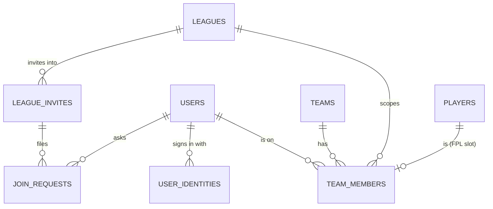

# 10 · Accounts and membership

How people sign in, and how one person plays in many leagues. This replaces the original model, where each team row was its own login handed out by an admin.

## Status

| Phase | What | State |
|---|---|---|
| 1 | Schema (migration 0025), `resolveTeamActor`, league-scoped viewer, route refactor, guard tests, database target guard | **Built** |
| 2 | Google sign-in, usernames, `/onboarding`, `/account`, in-app-browser handling, iOS handoff (behind a flag), role refresh and revocation, passwordless admins | **Built** |
| 3 | Members-mode leagues: invites, join, approval, partner invites, admin Members tab, league switcher, dashboard under `/[leagueSlug]` | **Built** |
| 4 | Sunset of legacy team logins after the 2026-27 season | Planned |

Phase 4 (sunset) is the only part not built yet.

## Two kinds of league

Every league has an `auth_mode`:

| | `legacy` | `members` |
|---|---|---|
| Who signs in | The **team**: team key + password the admin generated | A **person**: Google account, unique username |
| Session | `{ type: "team", id: teamId }` | `{ type: "user" \| "admin" \| "superadmin", id: userId, sv }` |
| Who is on a team | Whoever has the password | `team_members` rows |
| One person, many leagues | One login per team, juggled with the device account switcher | One identity; switching leagues is navigation |

All leagues that existed before migration 0025 are `legacy`, and stay that way until the 2026-27 season ends. New leagues are created as `members` unless the superadmin picks team logins.

FPL Classic leagues are public and have no accounts in either mode.

## Data model

Migration [`drizzle/0025_accounts_membership.sql`](../drizzle/0025_accounts_membership.sql) is purely additive. Apply it with [`scripts/apply-0025-accounts-membership.mjs`](../scripts/apply-0025-accounts-membership.mjs). The script is idempotent and refuses any database but this repo's own.



| Table / column | Purpose |
|---|---|
| `users` | Now **one row per person**: admins, superadmins and players. Adds `username` (unique, lowercase, null until onboarding), `avatar_url`, `fpl_entry_id`, `last_login_at` and `session_version`. Google-only accounts store `password = ""`. |
| `user_identities` | External sign-ins, unique on `(provider, provider_subject)`, e.g. Google's `sub`. |
| `team_members` | Who is on which team: `role` is `owner`/`member`, and `player_id` is the FPL slot this person fills. Unique `(league_id, user_id)` means **one team per person per league**. There is at most one owner per team (partial unique index). |
| `league_invites` | Invite links. `team_id` null = league invite (claims an open slot); set = partner invite. Has `max_uses`, `use_count`, `expires_at`, `revoked_at`, `requires_approval`. |
| `join_requests` | Joins waiting for an admin, via invites that require approval. |
| `auth_handoffs` | Five-minute, single-use records for the iOS home-screen sign-in handoff. |
| `leagues.auth_mode` | `legacy` (default for every existing row) or `members`. |
| `teams.team_login_id` | The **Team key**: a stable identifier that backups, restores and importers match teams by. It is a credential *only* in legacy leagues. |
| `audit_logs.user_id`, `.league_id` | Who and where, for membership events. |
| `submitted_by_user_id` on `gameweek_captains` / `gameweek_chips`; `feedback.submitter_user_id` | Which teammate did it. |

**Why the odd bits.**
- `users.password` and `teams.password` keep NOT NULL, and members-mode rows store `""`. `users.role` keeps its `"admin"` default, so every insert sets `role` explicitly.
- All three would otherwise mean rebuilding a SQLite table that other tables cascade from.

## Resolving the acting team

The rule: **the session says who you are; the URL says which league.**

[`src/lib/team-actor.ts`](../src/lib/team-actor.ts) is the only place a team-scoped API learns which team it is acting as:

- **`resolveTeamActor(request, { league?, teamId? })`** returns `{ actor: { teamId, leagueId, userId, memberRole } }` or `{ denial }`, where the denial is `"unauthenticated"`, `"league-required"` or `"forbidden"`.
  - A **legacy team login** is its own team. A `league` or `teamId` hint that disagrees with it is `forbidden`.
  - A **person** must name the league (`?league=<slug or id>`) or the team. Without one, the result is `league-required`.
  - One indexed query joins `team_members` to `users` and checks membership *and* `users.session_version == token.sv`. Removing a member, or bumping their session version, takes effect on their next request.
- **`sessionActsAsTeam(session, teamId)`**: for "only your own X" checks, where the request names the team (most auction routes).
- **`sessionTeamIdInLeague(session, league)`**: for read endpoints that flag "mine" in league-wide data.
- **`listSessionTeamIds(session)`**: every team the session may act as. This is what lets one notification bell cover all of a person's leagues.
- **`teamActorDenied(denial, messages?)`**: builds the JSON error response, keeping a route's existing wording.

Because the league comes from the URL and never from the cookie:
- switching leagues needs no token swap;
- deep links work;
- a stale tab can't submit a captain for a team its owner has since switched away from.

**Middleware** ([`src/middleware.ts`](../src/middleware.ts)) lets any valid session through to `/api/team/*`. It can't decide membership itself: that needs the league from the URL and a database lookup.

**Guard test.** [`tests/unit/team-actor-guard.test.ts`](../tests/unit/team-actor-guard.test.ts) fails if any file under `src/app/api/{team,auction,notifications,feedback}` reads `session.id` or `x-session-id`.
- In a legacy league that value *is* the team id. For a person it is a users id, so a route that kept reading it would silently skip its ownership check.
- An admin-only line that genuinely wants the users id opts out with `// team-actor-guard-ignore: <reason>`.

### Pages: the league-scoped viewer

The `[leagueSlug]` layout resolves the viewer with `resolveViewerInLeague(league.id)` ([`src/lib/viewer.ts`](../src/lib/viewer.ts)). Within one league:
- `viewer.teamId` is **my team in this league**: a legacy login for a team of this league, or a membership. It is absent otherwise.
- `viewer.isLeagueAdmin` covers superadmins and this league's admins.

League pages read these from `useLeague()` rather than fetching `/api/auth/me` themselves.

A person whose users row is gone, or whose session version is stale, reads as signed out.

## Never production's database

This repo carries schema production must not receive yet. [`src/lib/db/target-guard.ts`](../src/lib/db/target-guard.ts) allows only two kinds of database:
- local `file:` databases;
- the **`jpl-india`** Turso database.

It refuses everything else before a connection is opened, in three places:

| Where | Covers |
|---|---|
| `src/lib/db/index.ts` | The app, locally and on Vercel |
| `drizzle.config.ts` | `db:push`, `db:migrate`, `db:studio` |
| `scripts/apply-0025-accounts-membership.mjs` | The migration script (it repeats the check, because plain node can't import TypeScript) |

Production's database is `jpl-leagues`. Tests: [`tests/unit/db-target-guard.test.ts`](../tests/unit/db-target-guard.test.ts).

## Sign-in

```mermaid
sequenceDiagram
  participant B as Browser
  participant A as /api/auth/google
  participant G as Google
  participant C as /api/auth/google/callback
  B->>A: Continue with Google (next=/join/…)
  A->>B: state + PKCE verifier cookies, 302 to Google
  B->>G: consent
  G->>C: code + state
  C->>G: exchange code (arctic)
  C->>C: email_verified? find by (google, sub) → else link by email → else create role "user"
  C->>B: session cookie; → /onboarding if no username, else next
```

- **Library.** OAuth uses `arctic`, wired into the existing HMAC session. Auth.js and Better Auth would bring their own session and user model.
- **Admin auto-link.** An existing admin row links on first sign-in through its verified email.
- **Username rules.** `^[a-z0-9_]{3,20}$`, stored lowercase, with a reserved-words list.
- **In-app browsers.** WhatsApp, Instagram and Facebook webviews are blocked by Google. `/join` and `/signin` detect them by user agent and show "Open in Chrome/Safari" plus a copy-link button.
- **iOS home-screen app.** Its cookie jar is separate from Safari's. If a real-device test shows the plain redirect loses the cookie, switch on the one-time handoff (`NEXT_PUBLIC_IOS_HANDOFF=1`):
  1. The app holds a verifier and shows a 4-character code.
  2. The browser completes sign-in, then asks the user to confirm that code.
  3. The app polls and claims the session.
- **Revocation.** `users.session_version` is bumped by demotion, "sign out of all devices" and account replacement. Account deletion removes the row outright. Everything that checks a person re-reads role and version from the database:
  - `resolveTeamActor`, the league-scoped viewer and `/api/auth/me`;
  - `isSuperAdmin()` and `getAuthorizedLeagueId()`, through [`src/lib/privilege.ts`](../src/lib/privilege.ts).
- **Role refresh.** A promoted player keeps working: `/api/auth/me` re-mints their cookie at the new role. Admin pages call it on load.
- **Admins by email.** The superadmin page can create an admin from just an email, with no password, or promote an existing player.
  - Removing an admin who also plays, or signs in with Google, demotes them to a player and revokes their sessions.
  - A password-only admin with no team is deleted, as before.

| Route / page | Purpose |
|---|---|
| `GET /api/auth/google` → `GET /api/auth/google/callback` | Start and finish Google sign-in |
| `/onboarding` | Pick a username (and optionally your FPL ID) after first sign-in |
| `/account` | Profile, your leagues, sign out of all other devices, delete account |
| `GET/PATCH /api/me/profile` | Profile, live username check, FPL entry preview |
| `GET /api/me/leagues` | Teams, admin leagues, pending join requests |
| `POST /api/me/sessions` | Sign out of all other devices |
| `DELETE /api/me` | Delete account (teams stay; a shared team passes to the teammate) |
| `POST /api/auth/handoff` + `/auth/handoff` | iOS home-screen handoff (only with `NEXT_PUBLIC_IOS_HANDOFF=1`) |
| `POST /api/test-auth/signin` | Test-only sign-in for the e2e suite and previews (`TEST_AUTH_ENABLED=1`; never production) |

## Members-mode leagues

The logic lives in [`src/lib/membership.ts`](../src/lib/membership.ts). Every multi-row change runs in a transaction, and the unique indexes settle races: two people tapping the same invite can't get the same team.

- **League creation** (`POST /api/superadmin/leagues`, `authMode` default `members`).
  - Placeholder teams are still created, because fixtures and groups need a fixed `teamSize`. They get a Team key but no password.
  - The response includes an invite link: 14 days, one use per team.
  - The superadmin form asks "How teams sign in" and shows the link.
- **Join** (`/join/{token}` → `POST /api/join`). The page shows the one next step for this visitor:
  - open in a real browser, sign in, pick a username, join, or wait for approval;
  - or "already in this league", or a clear message for a broken link.
  - Joining claims the first open, non-ghost team as its owner, then lands on `/{slug}/setup`.
  - With approval on, it files a `join_requests` row instead.
- **Team setup** (`/{slug}/setup`, the same wizard as legacy `/setup`).
  - No login ID to choose.
  - Player 1 is prefilled from the person's profile.
  - On save, each member is linked to an FPL slot: owner = player 1, teammate = player 2.
- **Teammates** (TVT / Continental). From `/{slug}/team`, the owner creates a single-use, 7-day link (`/api/team/invite`). The partner joins as `member` in the free FPL slot.
  - The team can be complete without the partner ever having an account.
- **Dashboard** at `/{slug}/dashboard`. Every team API call carries `?league=`.
  - `/dashboard` keeps working for legacy logins.
  - For a person, it redirects to the league used last (`jpl_last_league` cookie, also used by the PWA `/launch`).
- **Switching.**
  - `LeagueSwitcher` sits in the drawer (always visible) and in the desktop account menu.
  - `/` shows "Your leagues" above the public list.
  - Inside a league, `LeagueNav` points Dashboard and Settings at that league's pages.
- **Admin Members tab** (`/api/admin/[leagueId]/members` and `/invites`):
  - slot states (Open / Claimed / Set up);
  - invite link: copy / new link / turn off / approval toggle;
  - join requests;
  - per team: assign by username, remove, replace account, make owner, release.
- **Recovery.**
  - A league admin's *Replace account* moves one seat.
  - The superadmin **Users** tab (`/api/superadmin/users`, `…/[id]/transfer`) moves every membership and admin right at once, then revokes the old account's sessions.
- **Backups.** Members leagues leave `Password` blank and add a read-only `Members` column. Restore keeps team rows, so memberships survive it (covered by an e2e test).
- **Format limits** (`MAX_TEAM_MEMBERS`): people per team — TVT 2, Continental 2, auction 1.
- **Help.** Format help shows sign-in questions by `league.authMode` (`accountFaqs` in `help/shared.tsx`), and admin help gains the invite and members workflows. Public `/help` and `/privacy` need no sign-in.

## Known issues and their handling

- **Local SQLite + concurrent writes.** On a local `file:` database, a transaction that loses a write race gets `SQLITE_BUSY`. The libsql local client then leaves that connection so that the next transaction which writes and rolls back keeps the database locked for every later query (reproduced in isolation). Membership writes are therefore queued one at a time per process (`writeTx` in `src/lib/membership.ts`), with a short retry on `SQLITE_BUSY` for hosted Turso. `tests/unit/membership.test.ts` races two joins for the last team and checks the database stays usable.
- **Foreign keys per connection.** `src/lib/db/index.ts` turns on `PRAGMA foreign_keys` once, but the local libsql client opens a fresh connection after every transaction, and the pragma doesn't follow. So `ON DELETE CASCADE` isn't guaranteed everywhere. This is an existing, app-wide issue. Code added here doesn't rely on it: account deletion removes identities, memberships, requests, admin rights and handoffs explicitly.
- **`pl-fixture-card` FPL-lookup test** fails without a test Redis. It fails the same way on the untouched production code (checked against a baseline worktree); see `09-environments.md` on adding one.
- **`next build --webpack`** rejects `src/app/api/auction/redeem-slot/route.ts` for exporting a helper. This also happens on production's code. The real build (`npm run build`, Turbopack) passes.

## Legacy coexistence and sunset

Until the 2026-27 season ends, legacy leagues keep team-key sign-in, `/change-password`, `/settings` and the device account switcher. The account switcher also holds a Google session, so one browser can move between both kinds.

After the season, Phase 4 removes all of that and the legacy branches in `team-actor.ts` and `viewer.ts`. Password sign-in remains only as a superadmin break-glass behind a flag.
